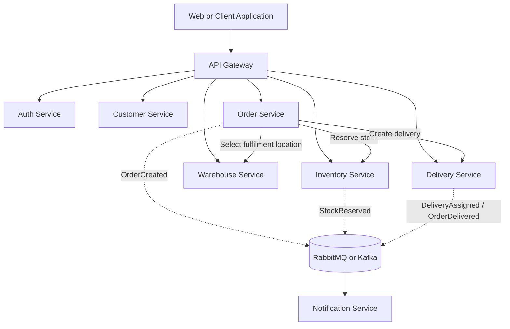

# SmartLogistics

SmartLogistics is a logistics and delivery management platform designed for businesses that need to manage customers, orders, warehouses, inventory, payments, and last-mile delivery from a single distributed system.

The platform is designed as a set of independently deployable ASP.NET Core microservices behind an API Gateway. Services own their business capabilities and data, communicate synchronously when an immediate response is required, and publish events for workflows that can be processed asynchronously.

> **Project status:** The .NET solution and service boundaries are scaffolded. Customer Service has the first working vertical slice with in-memory CRUD, validation, pagination, filtering, sorting, and unit coverage. Persistence, authentication, messaging, and the remaining domain workflows are being implemented incrementally.

## Goals

SmartLogistics is intended to support the complete delivery lifecycle:

- Register and manage customers
- Create and validate delivery orders
- Select warehouses and reserve inventory
- Assign delivery agents and track shipments
- Calculate charges and manage payments
- Publish operational events and notifications
- Provide secure, observable, and resilient APIs

## Architecture



### Services

| Service | Responsibility |
| --- | --- |
| **API Gateway** | Routes requests, applies authentication and authorization, and provides a centralized entry point. Rate limiting is a planned enhancement. |
| **Auth Service** | Registration, login, password hashing, JWT tokens, refresh tokens, and role-based authorization. |
| **Customer Service** | Customer creation, search, updates, deactivation, pagination, filtering, and sorting. |
| **Order Service** | Order creation, validation, payment state, order lifecycle, and coordination with inventory and delivery. |
| **Inventory Service** | Products, stock availability, reservations, releases, deductions, and low-stock alerts. |
| **Warehouse Service** | Warehouses, capacity, inventory mapping, availability, and fulfilment-location selection. |
| **Delivery Service** | Deliveries, agent assignment, delivery status, tracking, and estimated delivery times. |
| **Notification Service** | Consumes business events and sends customer or operational notifications. |

## Core Workflows

### Order lifecycle

Orders must move through valid states only:

```text
Created -> Confirmed -> Packed -> ReadyForDispatch
				-> Dispatched -> OutForDelivery -> Delivered
```

Invalid transitions, such as `Delivered -> Created`, must be rejected by the Order Service. State changes should be auditable and safe to retry.

### Inventory reservation

Inventory reservation must prevent overselling under concurrent requests. The implementation should use database transactions together with optimistic concurrency, row/version checks, or an equivalent locking strategy.

For example, if only 10 units are available, two simultaneous requests for 8 units must not both succeed.

### Delivery lifecycle

```text
Delivery Created -> Agent Assigned -> Picked Up
								 -> Out For Delivery -> Delivered
```

The Delivery Service exposes tracking information and manages agent assignment independently from order processing.

## Communication

Use synchronous REST/HTTP calls when the caller needs an immediate result, such as checking stock before confirming an order. Use asynchronous messaging for decoupled workflows and notifications.

Recommended events include:

- `OrderCreated`
- `StockReserved`
- `OrderPacked`
- `OrderDispatched`
- `DeliveryAssigned`
- `OrderDelivered`

Consumers should be idempotent so that redelivered messages do not duplicate reservations, notifications, payments, or status changes.

## Data Ownership

Each microservice should own its data and expose it through its API or events. Do not use one shared database as the default architecture.

| Service | Preferred database boundary |
| --- | --- |
| Customer Service | Customer database |
| Order Service | Order database |
| Inventory Service | Inventory database |
| Warehouse Service | Warehouse database |
| Delivery Service | Delivery database |
| Auth Service | Identity database |

SQL Server and Entity Framework Core are the preferred persistence technologies. Schemas should use appropriate primary keys, foreign keys, constraints, indexes, normalized relationships, and transactions. The core domain model includes users, customers, orders, order items, products, inventory, warehouses, deliveries, delivery agents, and payments.

### Database Schema Ownership

The minimum relational model is split by service boundary:

| Database | Tables | Relationship notes |
| --- | --- | --- |
| Auth DB | `Users`, `RefreshTokens` | Refresh tokens reference users with a foreign key and cascade delete. |
| Customer DB | `Customers` | Customer email is unique and indexed. |
| Order DB | `Orders`, `OrderItems`, `Payments` | Order items and payment attempts reference orders with foreign keys and cascade delete. Product, customer, and warehouse IDs are cross-service references, not cross-database foreign keys. |
| Inventory DB | `Products`, `Inventory` | Inventory has a one-to-one product relationship, unique SKU, row-version concurrency, and quantity indexes. |
| Warehouse DB | `Warehouses`, `WarehouseInventory` | Warehouse inventory uses a composite key and a warehouse foreign key. Product IDs are owned by Inventory Service. |
| Delivery DB | `Deliveries`, `DeliveryStatusEvents`, `DeliveryAgents` | Status events and assigned agents reference deliveries and agents with foreign keys. Order IDs are owned by Order Service. |

Constraints include positive monetary and quantity checks, required bounded strings, unique business identifiers, composite keys, and indexes for customer/order, warehouse/status, stock availability, delivery tracking, and agent availability queries. Independent service databases communicate through APIs and integration events rather than a shared schema.

### EF Core Practices

The services use EF Core Code First with Fluent API mappings and checked-in migrations. Database work is asynchronous and cancellation-aware. Read paths use `AsNoTracking`, server-side `Where` filtering, `OrderBy`, `Skip`/`Take` pagination, and `Select` projections before materialization. Inventory mutations use explicit serializable transactions and row-version concurrency; related Order and Delivery writes use concurrency tokens and foreign-key relationships. Queries avoid materializing entire tables before filtering.

### Advanced C# Practices

Order Service demonstrates the requested language and design features in `OrderProcessing.cs`:

- `IOrderProcessor` and dependency injection for the application boundary
- Generic `OperationResult<T>` and `AsyncOperation<TRequest, TResponse>` abstractions
- `OrderStatusChangedHandler` delegate for status notifications
- Extension methods for identifier validation and next-status calculation
- Records for immutable operation results and request/response contracts
- Pattern matching for the order lifecycle state machine
- Nullable reference types and explicit failure results
- Async processing with `CancellationToken`

The cancellation-aware endpoint is:

```http
POST /api/orders/{id}/process
```

It advances an order by one valid lifecycle state and rejects terminal or invalid processing attempts.

## API Examples

The API Gateway is the public entry point. Service APIs should use consistent REST conventions and validation responses.

### Authentication

```http
POST /api/auth/register
POST /api/auth/login
POST /api/auth/refresh
```

### Customers

```http
POST   /api/customers
GET    /api/customers/{id}
GET    /api/customers?page=1&pageSize=20&status=Active
PUT    /api/customers/{id}
DELETE /api/customers/{id}
```

### Inventory

```http
GET  /api/inventory/{productId}
POST /api/inventory/reserve
POST /api/inventory/release
```

### Deliveries

```http
POST /api/deliveries
POST /api/deliveries/{id}/assign
PUT  /api/deliveries/{id}/status
GET  /api/deliveries/{id}/tracking
```

Swagger/OpenAPI should be enabled for discovering and testing the APIs.

## Security

The platform should use:

- JWT bearer authentication
- Role-based authorization
- Secure password hashing
- Refresh tokens where supported
- Validation at API boundaries
- No sensitive data, internal exceptions, or stack traces in responses

The initial roles are:

`Admin`, `OperationsManager`, `WarehouseManager`, `DeliveryAgent`, and `Customer`.

## Error Handling and Observability

ASP.NET Core middleware should handle exceptions centrally and return a consistent error shape:

```json
{
	"success": false,
	"errorCode": "ORDER_NOT_FOUND",
	"message": "The requested order does not exist."
}
```

Structured logging should use Serilog or an equivalent framework. Logs should include the request ID, correlation ID, service name, exception details, and processing time without exposing secrets or personal data unnecessarily.

Task 12 is implemented through `src/Shared.Infrastructure` and is wired into every ASP.NET service and the API Gateway. The middleware:

- Adds or preserves `X-Correlation-Id`
- Logs request start and completion
- Logs HTTP method, path, response status, service name, correlation ID, and processing time
- Logs unhandled exceptions with stack traces to Serilog sinks only
- Returns a safe, consistent response without internal exception details:

```json
{
	"success": false,
	"errorCode": "INTERNAL_SERVER_ERROR",
	"message": "An unexpected error occurred."
}
```

Known application errors can use `ApiException` to provide a safe status code and error code while keeping exception details out of the response. Serilog writes structured events to the console and can be extended through configuration with file or centralized sinks.

## Resilience and Performance

Service-to-service calls should define timeouts and use bounded retries only where retrying is safe. Circuit breakers and fallback responses should protect the system when a dependency is unavailable. Indiscriminate retries can amplify load during an outage, duplicate non-idempotent operations, and make recovery slower.

Redis is a planned caching option for frequently read data such as products, warehouses, customer configuration, and delivery zones. Every cache entry needs an expiration and an invalidation strategy.

The design should also account for:

- SQL query projection and server-side filtering
- Pagination before materializing results
- Appropriate indexes and query plans
- Horizontal service scaling and load balancing
- Message backlogs and consumer scaling
- Idempotent command and event processing
- Recovery when a service instance crashes

## Technology Stack

| Area | Technology |
| --- | --- |
| Language | C# with nullable reference types |
| Web | ASP.NET Core Web API |
| Data access | Entity Framework Core, LINQ, SQL Server |
| API style | REST, Swagger/OpenAPI |
| Messaging | RabbitMQ or Kafka |
| Caching | Redis (planned) |
| Security | JWT and role-based authorization |
| Logging | Serilog (planned) |
| Containers | Docker and Docker Compose |
| Testing | xUnit, Moq, and integration-test tooling |

## Current Implementation

The first runnable slices are Customer Service, Authentication, Delivery Service, Order Service, Inventory Service, and Warehouse Service:

- `POST /api/customers` creates an active customer
- `GET /api/customers/{id}` retrieves a customer
- `GET /api/customers` supports pagination, status filtering, and sorting
- `PUT /api/customers/{id}` updates customer details
- `DELETE /api/customers/{id}` deactivates a customer
- Input validation returns standard ASP.NET validation responses
- SQL Server persistence is wired through EF Core with a service-owned `Customers` table
- Customer queries use no-tracking reads, database-side filtering, sorting, projection, and pagination
- The in-memory store remains available for isolated unit tests

Authentication and authorization currently provide:

- `POST /api/auth/register` with password validation and Customer as the safe public default role
- `POST /api/auth/login` with PBKDF2 password verification
- `POST /api/auth/refresh` with hashed, one-time-use refresh-token rotation
- JWT access tokens containing user ID, email, display name, and role claims
- `GET /api/auth/me` for any authenticated user
- `GET /api/auth/admin-check` protected by the `Admin` role policy
- Configuration-driven issuer, audience, signing key, and token lifetimes

### API Documentation

When Auth Service is running in the Development environment, interactive API documentation is available at:

- Swagger-style UI: `http://localhost:5084/swagger`
- OpenAPI JSON: `http://localhost:5084/openapi/v1.json`

The UI documents registration, login, refresh, current-user, and admin authorization endpoints. Use the login response access token as a Bearer token when testing protected endpoints.

Users and refresh tokens are persisted by Auth Service through EF Core and SQL Server. The schema includes unique email and refresh-token-hash indexes, a user foreign key, expiration lookup support, and a concurrency stamp that prevents a refresh token from being successfully replayed.

Apply the Auth schema with:

```bash
dotnet ef database update --project src/AuthService/AuthService.csproj --startup-project src/AuthService/AuthService.csproj
```

Auth Service reads the database and signing key from configuration. The signing key is intentionally absent from committed `appsettings.json` and must be supplied through secure environment configuration or a secret manager:

```powershell
$env:ConnectionStrings__AuthDb = "Server=localhost;Database=SmartLogisticsAuth;Trusted_Connection=True;TrustServerCertificate=True;"
$env:Jwt__SigningKey = "use-a-random-secret-at-least-32-bytes-long"
dotnet run --project src/AuthService/AuthService.csproj
```

Never commit a real signing key. Rotate it through the deployment secret-management process; changing it invalidates existing access tokens.

Delivery Service currently provides:

- `POST /api/deliveries` to create a delivery
- `POST /api/deliveries/{id}/assign` to assign a delivery agent
- `PUT /api/deliveries/{id}/status` to advance the delivery lifecycle
- `GET /api/deliveries/{id}` to retrieve delivery details
- `GET /api/deliveries/{id}/tracking` to retrieve status history
- Guarded transitions from `Created` to `Assigned`, `PickedUp`, `OutForDelivery`, and `Delivered`
- SQL Server persistence for deliveries and status events through EF Core
- Concurrency stamps on delivery records and indexes for orders, agents, statuses, and tracking queries

Apply the Delivery schema with:

```bash
dotnet ef database update --project src/DeliveryService/DeliveryService.csproj --startup-project src/DeliveryService/DeliveryService.csproj
```

Delivery Service reads its database from `ConnectionStrings:DeliveryDb` and can be started with `ConnectionStrings__DeliveryDb` in environment configuration.

Order Service currently provides:

- `POST /api/orders` to create an order with Customer, Warehouse, amount, address, order status, and payment status
- `GET /api/orders/{id}` to retrieve an order
- `PUT /api/orders/{id}/status` to advance the order lifecycle
- `PUT /api/orders/{id}/payment-status` to update payment state
- Validation for required customer and warehouse IDs, positive order totals, and delivery addresses
- Guarded transitions from `Created` through `Confirmed`, `Packed`, `ReadyForDispatch`, `Dispatched`, `OutForDelivery`, and `Delivered`
- SQL Server persistence through EF Core with concurrency stamps and indexes for customer and warehouse lookups

Apply the Order schema with:

```bash
dotnet ef database update --context OrderDbContext --project src/OrderService/OrderService.csproj --startup-project src/OrderService/OrderService.csproj
```

Order Service reads its database from `ConnectionStrings:OrderDb` and can be started with `ConnectionStrings__OrderDb` in environment configuration.

Inventory Service currently provides:

- `POST /api/inventory/products` to add a product and initial stock
- `PUT /api/inventory/products/{productId}` to update product details and the low-stock threshold
- `GET /api/inventory/{productId}` to read availability and low-stock state
- `POST /api/inventory/reserve` to reserve available stock
- `POST /api/inventory/release` to return reserved stock to availability
- `POST /api/inventory/deduct` to consume reserved stock after fulfillment
- SQL Server persistence for products and inventory records through EF Core
- Serializable transactions, row-version concurrency checks, and serialized in-process mutations to prevent overselling

The two-request scenario where 10 units are available and two callers request 8 units results in exactly one successful reservation. The second request receives a conflict response and available stock cannot become negative.

Apply the Inventory schema with:

```bash
dotnet ef database update --context InventoryDbContext --project src/InventoryService/InventoryService.csproj --startup-project src/InventoryService/InventoryService.csproj
```

Inventory Service reads its database from `ConnectionStrings:InventoryDb` and can be started with `ConnectionStrings__InventoryDb` in environment configuration.

Warehouse Service currently provides:

- `POST /api/warehouses` to create a warehouse with capacity and location
- `GET /api/warehouses/{id}` to read warehouse availability and capacity
- `PUT /api/warehouses/{id}` to update warehouse details, capacity, and availability
- `POST /api/warehouses/{id}/inventory` to map product quantities to a warehouse
- `POST /api/warehouses/select` to select a fulfilment warehouse for requested products
- Capacity validation that prevents inventory mappings from exceeding warehouse capacity
- Eligibility filtering by warehouse availability, total requested capacity, and product quantities
- Nearest eligible warehouse selection using customer and warehouse coordinates
- SQL Server persistence for warehouses and warehouse inventory mappings through EF Core

Apply the Warehouse schema with:

```bash
dotnet ef database update --context WarehouseDbContext --project src/WarehouseService/WarehouseService.csproj --startup-project src/WarehouseService/WarehouseService.csproj
```

Warehouse Service reads its database from `ConnectionStrings:WarehouseDb` and can be started with `ConnectionStrings__WarehouseDb` in environment configuration.

## Service Communication

Task 7 communication is implemented with two patterns:

- **Synchronous REST:** Order Service uses the configured `ServiceEndpoints:DeliveryServiceUrl` to create a delivery when an order reaches `Dispatched`.
- **Asynchronous RabbitMQ:** Order Service publishes `OrderCreated`, `OrderPacked`, `OrderDispatched`, and `OrderDelivered` events to the `smartlogistics.events` topic exchange. Notification Service consumes these events from its durable `notification-service` queue. Inventory and Delivery Services can publish `StockReserved` and `DeliveryAssigned` using the same shared contracts.

Shared event names and payload contracts are defined in `src/Shared.Contracts/IntegrationEvents.cs`. RabbitMQ settings are configured with the `RabbitMq` section or environment variables such as `RabbitMq__HostName` and `RabbitMq__Port`.

If RabbitMQ is unavailable, Order Service logs the publishing failure and preserves the database operation. A transactional outbox is the next resilience improvement for guaranteed event delivery.

## Resilience

Order Service uses `Microsoft.Extensions.Http.Resilience` for its synchronous Delivery Service client:


Retries are limited to transient failures and must not be applied indiscriminately. Unlimited or broad retries can multiply traffic while a dependency is unhealthy, create retry storms, increase latency, duplicate non-idempotent operations, and delay recovery. Commands such as payment, reservation, and delivery creation should be idempotent before retrying them; durable event delivery through an outbox is preferred when a database write and event publication must be atomic.

## Caching

Task 14 uses Redis through `IDistributedCache` with a cache-aside strategy:

- Inventory product availability uses keys such as `inventory:product:{id:N}` with a five-minute sliding expiration and 30-minute absolute expiration.
- Warehouse details use `warehouse:{id:N}` with a five-minute sliding expiration and 15-minute absolute expiration.
- Warehouse selection results use a request-specific key containing customer coordinates and sorted product quantities.
- Product and warehouse cache entries are invalidated after stock changes, product updates, warehouse updates, and inventory mapping changes.
- Cache read/write/invalidation failures are logged and fail open to SQL Server, so Redis availability is not required for correctness.

Configure Redis with `ConnectionStrings:Redis` or `ConnectionStrings__Redis`:

```powershell
$env:ConnectionStrings__Redis = "localhost:6379"
```

Expiration limits stale data; mutation invalidation keeps frequently changing stock and capacity data accurate. Redis should be deployed as a shared cache for service instances rather than an in-process memory cache.

## API Gateway

The API Gateway is implemented with YARP and is available at `http://localhost:5132` in Development. It provides:

- Public routing for `/api/auth/*`
- JWT-authenticated routing for Customer, Order, Inventory, Warehouse, and Delivery APIs
- Service destinations configured in `src/ApiGateway/appsettings.json`
- `X-Correlation-Id` propagation and centralized request timing logs
- IP-based rate limiting of 100 proxied requests per minute
- `GET /health` for gateway health checks

The Gateway validates the same JWT issuer, audience, and signing key as Auth Service. Supply the key securely with `Jwt__SigningKey`; do not commit it to configuration.

Customer Service reads its SQL Server connection from `ConnectionStrings:CustomerDb`. The default local development value targets `localhost` and can be overridden through environment-specific configuration.

Run its tests with:

```bash
dotnet test tests/CustomerService.Tests/CustomerService.Tests.csproj
dotnet test tests/AuthService.Tests/AuthService.Tests.csproj
dotnet test tests/DeliveryService.Tests/DeliveryService.Tests.csproj
dotnet test tests/OrderService.Tests/OrderService.Tests.csproj
dotnet test tests/InventoryService.Tests/InventoryService.Tests.csproj
dotnet test tests/WarehouseService.Tests/WarehouseService.Tests.csproj
```

## Development Practices

The implementation should demonstrate:

- Dependency injection and clear service boundaries
- Async APIs with `CancellationToken` support
- Interfaces, records, generics, extension methods, and pattern matching where they improve the design
- EF Core Code First migrations and Fluent API configuration
- Efficient LINQ queries that filter and project in the database
- Repository or application-service patterns where they add value
- Consistent validation and domain rules
- Correlation IDs and structured logs across service calls

## Testing Strategy

### Unit tests

Unit tests should cover business rules without infrastructure dependencies, including order creation, state transitions, inventory reservation, delivery assignment, authentication, and validation. Use xUnit and Moq where appropriate.

### Integration tests

Integration tests should verify boundaries such as API-to-database behavior, API-to-service communication, authentication, and protected endpoints.

End-to-end tests can then verify the most important workflows across the deployed services.

## Local Development

The target local environment is Docker Compose with the platform dependencies and core services:

- API Gateway
- Auth, Customer, Order, Inventory, Warehouse, Delivery, and Notification Services
- SQL Server
- RabbitMQ
- Redis

Once the implementation is available, the expected startup flow should be documented as:

```bash
docker compose up --build
```

Connection strings, JWT settings, broker settings, and cache settings should be supplied through environment variables or local development configuration. Secrets must not be committed to the repository.

## Repository Structure

```text
SmartLogistics/
├── src/
│   ├── ApiGateway/
│   ├── AuthService/
│   ├── CustomerService/
│   ├── OrderService/
│   ├── InventoryService/
│   ├── WarehouseService/
│   ├── DeliveryService/
│   └── NotificationService/
├── tests/
│   ├── OrderService.Tests/
│   ├── InventoryService.Tests/
│   └── CustomerService.Tests/
├── architecture/
│   └── PROJECT_BLUEPRINT.md
├── docker-compose.yml
└── README.md
```

## Delivery Roadmap

1. Establish the solution structure, shared conventions, configuration, and Docker Compose foundation.
2. Implement authentication, roles, JWT validation, and the API Gateway.
3. Build Customer, Warehouse, and Inventory Services, including safe stock reservation.
4. Build the Order Service with validation and guarded state transitions.
5. Build the Delivery and Notification Services and connect the main order workflow.
6. Add messaging, idempotency, retries, timeouts, circuit breakers, and correlation logging.
7. Add Redis caching, operational dashboards, integration tests, and production-oriented health checks.
8. Run load and failure scenarios, then document scaling and recovery decisions.

## Production Scenario

For a workload in which 10,000 customers place orders while inventory slows down, the message broker builds a backlog, SQL Server reaches high CPU, and a Delivery Service instance fails, the system should scale service instances independently, protect dependencies with timeouts and circuit breakers, scale message consumers, optimize and index database queries, use idempotent processing, load-balance healthy instances, and monitor queue depth, latency, error rate, database CPU, and recovery time.

The design should favor graceful degradation and recoverable workflows over synchronous chains that require every service to be healthy at the same moment.

## Reference Blueprint

The detailed requirements and original architecture brief are maintained in [architecture/PROJECT_BLUEPRINT.md](architecture/PROJECT_BLUEPRINT.md).
